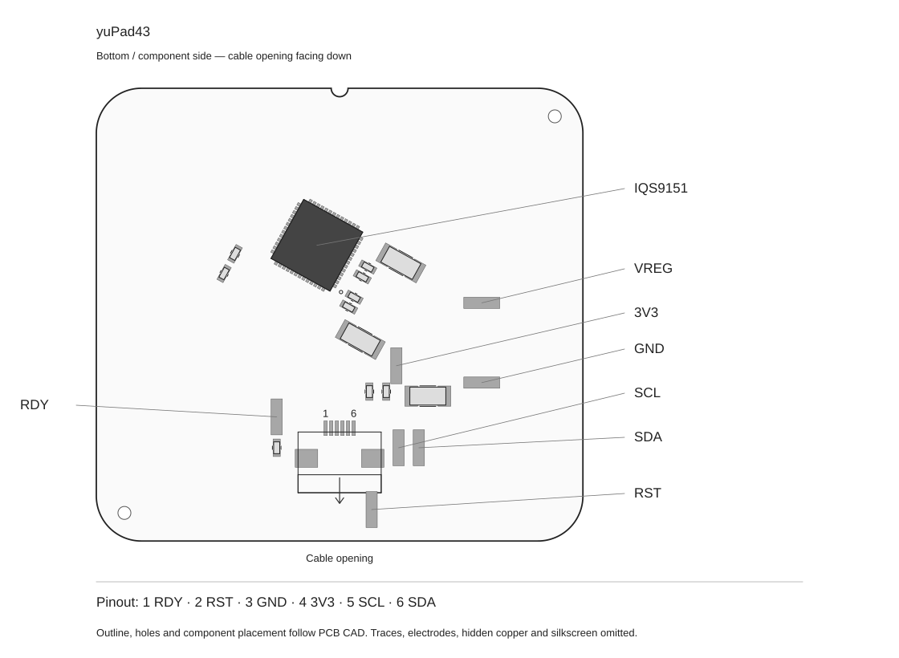

# yuPad43

[日本語](README.md) | English

yuPad43 is a 43.3 × 40.3 mm touchpad built around the IQS9151. It connects to a keyboard or microcontroller over I²C for pointer control and scrolling.

- **Use with ZMK:** [Setup and configuration example](docs/zmk.en.md)
- **Integrate with other firmware:** [Communication, configuration data, and output format](docs/integration.en.md)
- **Design a case:** [Dimensions, component heights, and STEP model](docs/mechanical.en.md)

## Connection

The illustration shows the component side, with the connector's cable opening facing down. Numbers 1–6 identify the connector's solder terminals on the board; they are not a cable-side numbering reference. The illustration shows component placement and is not a dimensioned manufacturing drawing.

| Pin | Signal | Host connection |
| --- | --- | --- |
| 1 | RDY | GPIO input. Low indicates that the IC is ready for communication. |
| 2 | RST / MCLR | Active-low reset. Leave unconnected if unused; do not tie to GND. |
| 3 | GND | Host ground. |
| 4 | 3V3 | 3.3 V supply. Do not connect to 5 V. |
| 5 | SCL | I²C clock. |
| 6 | SDA | I²C data. |

SCL, SDA, and RDY each have a 4.7 kΩ pull-up to 3.3 V on the board. MCLR has a 10 kΩ pull-up to 3.3 V. Account for these parallel resistances if your host has additional pull-ups. The VREG pad is for checking the IC's internal supply, not for powering external devices.

The connector is an AFC01-S06FCA-00 with six pins at a 0.5 mm pitch. Check the contact orientation and signal mapping at both ends of the cable rather than relying on a “Type A/B” label alone. Disconnect power before inserting or removing the cable.

## Installation and operation

Secure a nonconductive cover against the touch surface. Single-finger pointer control and two-finger scrolling have been checked with a 1 mm PLA cover. Check the response after installation if you change the material, thickness, or mounting method.

1. Connect the board with power off, then secure the board and cover.
2. Keep your fingers off the touch surface and turn on the power. Calibration runs at startup.
3. Move one finger across the center and just inside the edges. Check for continuous movement and that input stops when you lift your finger.
4. Place two fingers slightly apart and move them vertically and horizontally to check scrolling.

## Default settings

| Item | Value |
| --- | --- |
| Power and interface | 3.3 V, I²C (address 0x56) |
| Electrodes | 10 RX × 9 TX |
| Calibration target | 400 |
| Touch thresholds | Touch: 30; release: 26 |
| Scroll level | 0 (standard) |
| PCB thickness | 1.0 mm |

The ZMK example is configured for USB.

## Resources

- [ZMK driver](https://github.com/yuchamichami/zmk-driver-yupad43/blob/main/README.en.md) / [XIAO nRF52840 configuration example](firmware/xiao-example/)
- [Configuration JSON](data/yuPad43-profile.json) / [Register writes CSV](data/register-writes.csv) / [Frame decoder example](data/decode_frame.py)
- [STEP model for case design](docs/mechanical/yuPad43-case-envelope.step)

This repository provides connection and firmware integration resources. PCB schematics, routing, and manufacturing files are not included.

## License

The separately maintained ZMK driver is based on [ShiniNet / zmk-driver-iqs9151](https://github.com/ShiniNet/zmk-driver-iqs9151), licensed under the MIT License, with changes to the electrode configuration, initialization settings, and ATI communication for yuPad43.

Copyright (c) 2026 ShiniNet

The full license is included in [THIRD-PARTY-LICENSE.txt](docs/licenses/THIRD-PARTY-LICENSE.txt).
