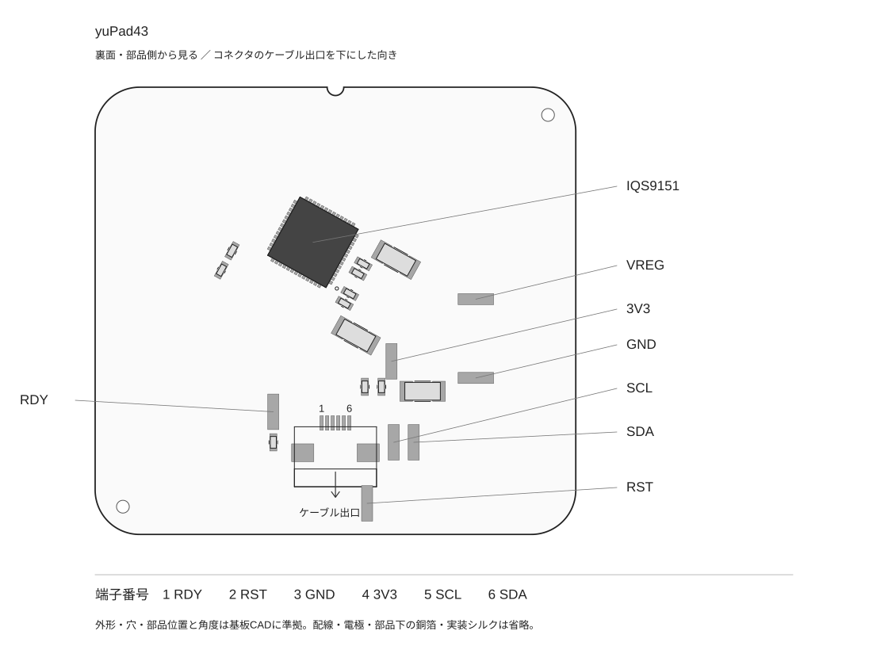

# yuPad43

日本語 | [English](README.en.md)

yuPad43は、IQS9151を搭載した43.3 × 40.3 mmのタッチパッドです。I²Cでキーボードやマイコンへ接続し、カーソルやスクロールを操作できます。

- **ZMKで使う：** [導入手順と設定例](docs/zmk.md)
- **他のファームへ組み込む：** [通信仕様・設定データ・出力形式](docs/integration.md)
- **ケースを作る：** [寸法図・部品高さ・STEP](docs/mechanical.md)

## 接続

部品のある裏面を見て、コネクタのケーブル出口を下にした図です。1〜6は基板コネクタのはんだ端子番号です。ケーブルを反対側から見た番号とは区別してください。図は部品位置の案内用で、寸法・加工用ではありません。

| 端子 | 信号 | ホストとの接続 |
| --- | --- | --- |
| 1 | RDY | GPIO入力。LowのときICが通信可能。 |
| 2 | RST / MCLR | Lowでリセット。使用しない場合は開放。GND固定にしない。 |
| 3 | GND | ホストGND。 |
| 4 | 3V3 | 3.3 V電源。5 Vを接続しない。 |
| 5 | SCL | I²Cクロック。 |
| 6 | SDA | I²Cデータ。 |

基板上ではSCL・SDA・RDYをそれぞれ4.7 kΩで3.3 Vへ、MCLRを10 kΩで3.3 Vへプルアップしています。追加のプルアップは既存回路との並列抵抗を考慮してください。VREGパッドはIC内部電源の確認用で、外部への給電には使いません。

コネクタはAFC01-S06FCA-00、0.5 mmピッチ・6ピンです。ケーブルの「Type A/B」だけで接続を決めず、相手コネクタの接点面と両端の信号対応を確認してください。電源を切ってから抜き差ししてください。

## 取り付けと動作確認

基板のタッチ面に、非導電性のカバーを密着させて固定します。1 mm厚のPLAカバーで1本指のカーソル操作と2本指のスクロールを確認しています。材質・厚さ・固定方法が変わる場合は、装着後に反応を確認してください。

1. 電源を切った状態で接続し、カバーと基板を固定します。
2. タッチ面から手を離して電源を入れます。起動時に自動校正します。
3. 中央と端の少し内側を1本指でなぞり、途切れや指を離した後の誤反応がないことを確認します。
4. 2本指を少し離して置き、上下・左右へ動かしてスクロールを確認します。

## 基本設定

| 項目 | 値 |
| --- | --- |
| 電源・通信 | 3.3 V・I²C（アドレス0x56） |
| 電極 | 10 RX × 9 TX |
| 校正目標 | 400 |
| タッチ判定 | 開始30・解除26 |
| スクロール量 | 0（標準） |
| 基板厚 | 1.0 mm |

ZMK設定例はUSB接続用です。

## 資料

- [ZMKドライバ](https://github.com/yuchamichami/zmk-driver-yupad43) / [XIAO nRF52840用設定例](firmware/xiao-example/)
- [設定JSON](data/yuPad43-profile.json) / [レジスタ一覧CSV](data/register-writes.csv) / [出力の解釈例](data/decode_frame.py)
- [部品付きSTEPモデル](docs/mechanical/yuPad43-case-envelope.step)

このリポジトリでは接続・組込み用の情報を提供しています。基板の回路図・配線・製造データは含みません。

## ライセンス

別リポジトリのZMK用ドライバは、[ShiniNet / zmk-driver-iqs9151](https://github.com/ShiniNet/zmk-driver-iqs9151)（MIT License）を基に、このパッド向けの電極設定・初期化設定・ATI通信処理を変更しています。

Copyright (c) 2026 ShiniNet
ライセンス全文は [THIRD-PARTY-LICENSE.txt](docs/licenses/THIRD-PARTY-LICENSE.txt) に収録しています。
