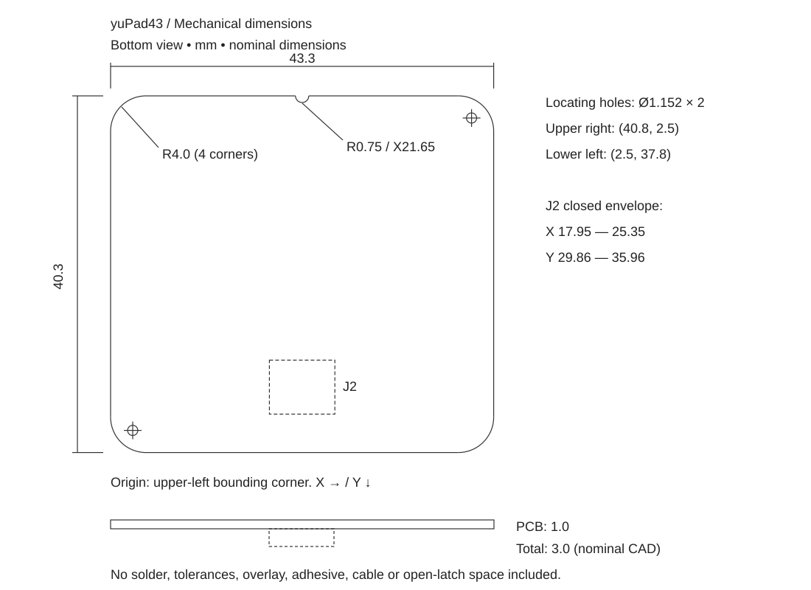

# Dimensions and case design

[日本語](mechanical.md) | English

These dimensions describe the 1.0 mm PCB version of yuPad43. The drawing is a bottom view, with the cable opening facing down. The origin is the upper-left corner of the board's bounding rectangle; X increases to the right and Y downward. The top view is mirrored horizontally.

## Dimensions

All dimensions are in millimeters.

| Item | Nominal dimensions |
| --- | --- |
| Outline | 43.3 × 40.3; use these dimensions rather than the TPS43's nominal 43 × 40. |
| PCB | 1.0 thick, four-layer FR-4. |
| Corners | R4.0 on all four corners. |
| Top-center notch | Semicircle, R0.75; center at (21.65, 0). |
| Locating holes | Ø1.152 × 2; centers at (40.8, 2.5) and (2.5, 37.8), viewed from below. These are locating holes, not screw mounting holes. |
| Connector position | Centerline X=21.65; CAD footprint origin Y=31.6. The footprint origin is not the cable opening or the component's geometric center. |
| Closed connector envelope | X=17.95–25.35, Y=29.86–35.96; width 7.4 × depth 6.1. The model ends 4.34 from the board's lower edge. |
| Component height above PCB | Maximum 2.0 at the connector. IC: 0.75; large capacitors: 1.6; small capacitors: 0.5; resistors: 0.35. |
| PCB plus components | 3.0 nominal. Add space for the overlay, adhesive, solder, and manufacturing tolerances. |

## STEP model

The [case envelope STEP](mechanical/yuPad43-case-envelope.step) contains the board outline, locating holes, and rectangular component envelopes. It omits traces, electrodes, and vias.

Z=0 is the touch surface. The board occupies Z=0–1 and components extend to Z=3. The component envelopes are based on nominal CAD models; allow additional clearance for manufacturing and assembly. The IC and connector use simplified models, and passive components use generic models.

The [dimension JSON](mechanical/yuPad43-mechanical.json) provides outline, hole, and component-envelope measurements. Nominal dimensions and suggested case clearances are recorded separately.

## Case clearance and support

As a starting point, 0.3 mm clearance per side gives a 43.9 × 40.9 mm pocket. Offset the rounded outline as well. Adjust the fit for your printer, the actual board, and any remaining panel tabs or burrs.

Allow height for:

**Cover + adhesive or gap + 1.0 mm PCB + component space + assembly clearance**

Allow more than the nominal 2.0 mm component height. Support component-free areas with a continuous ledge so the board does not flex. Do not press on the capacitors or connector.

## Cover and cable

Choose a nonconductive cover and keep its thickness and contact with the board uniform. Check the response with the actual cover and mounting arrangement. Avoid metal or conductive coatings over the touch surface.

The connector has six contacts at a 0.5 mm pitch, bottom contacts, and accepts 0.3 mm thick FFC/FPC. Leave room for the latch, cable stiffener, and fingers or tools used for insertion and removal.

The STEP model does not include the open latch or cable bend space. The 4.34 mm distance to the board edge is not a cable bend specification. Keep the stiffener straight and check the routing against your cable's dimensions.

[Back to the connection and usage guide](../README.en.md)
