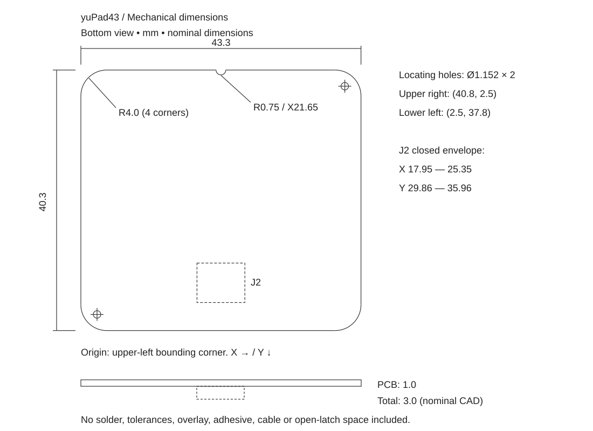

# 寸法・ケース設計

以下はyuPad43の板厚1.0 mm版の設計値です。寸法図は裏面を見て、ケーブル出口を下にした向き。左上の外接矩形の角が原点で、Xは右、Yは下へ増えます。表側から見た図とは左右が反転します。

| 項目 | 設計値・意味 |
| --- | --- |
| 外形 | 43.3 × 40.3 mm。TPS43公称43 × 40 mmと同寸ではありません。 |
| 板厚 | 1.0 mm、公称。4層FR-4。 |
| 四隅 | R4.0 mm。 |
| 上辺中央の切欠き | 半径0.75 mmの半円。中心X=21.65、Y=0。 |
| 位置決め穴 | 直径1.152 mm × 2。裏面視で中心（40.8, 2.5）、（2.5, 37.8）。ねじ締結用として設計・強度保証した穴ではありません。 |
| コネクタ位置 | 中心線X=21.65。CAD上の部品原点Y=31.6。原点はケーブル入口や部品の外形中心ではありません。 |
| コネクタの公称包絡 | X=17.95〜25.35、Y=29.86〜35.96。幅7.4 × 奥行6.1 mm。モデル下端から基板下辺まで4.34 mm。 |
| 部品側の突出高さ | 公称モデルでは最大2.0 mm（コネクタ）。IC 0.75 mm、大きいコンデンサ1.6 mm、小さいコンデンサ0.5 mm、抵抗0.35 mm。 |
| 基板＋部品の厚さ | 公称モデルで3.0 mm。オーバーレイ、接着材、はんだ高さ、公差は含みません。 |

[ケース検討用STEP](mechanical/yuPad43-case-envelope.step)は、実基板の外形・位置決め穴と、部品の外接直方体で構成しています。配線・電極・ビアは含みません。Z=0がタッチ面、基板はZ=0〜1、部品はZ=1〜3です。部品の直方体は公称CADに基づく逃げ検討用で、最大公差込みの保証包絡ではありません。IC・コネクタは簡略モデル、受動部品は汎用モデルに由来します。

### ケース側に残す余裕

基板と同じ43.3 × 40.3 mmのポケットへ隙間なく押し込む設計は避けます。試作開始値として片側0.3 mmの隙間なら、外接寸法は43.9 × 40.9 mmです。ただしこれはFDMや基板製造の誤差を保証する値ではなく、実際のプリンタ・実基板・切り離し後のバリで確認してください。角も元外形をオフセットして逃がします。

高さは「カバー厚＋接着材または隙間＋基板1.0 mm＋部品側の必要空間＋組立余裕」で決めます。部品側は公称2.0 mmに余裕を加え、ケースでコンデンサやコネクタを押さえないでください。部品のない部分を使った連続した受け面で支持し、基板がたわまないようにします。

### カバーとケーブル

オーバーレイの材質・厚さはケース設計に合わせて選び、実際の積層状態で感度を確認します。金属や導電性塗装でタッチ面を覆う前提にはしません。密着状態と厚さが局所的に変わらない取り付けにしてください。筐体やカバーを取り替えた場合は同じ設定で体験が維持されるかを再確認します。

コネクタは0.5 mmピッチ、6ピン、下接点、適合FFC/FPC厚0.3 mmの製品です。ラッチの開閉、ケーブル補強板、抜き差しする指・工具の空間を別に確保します。STEPにはラッチ開状態・ケーブル・曲げ空間を含めていません。基板端まで4.34 mmあることは、全ケーブルをそこで折り曲げられる意味ではありません。補強板を無理に曲げず、採用ケーブルの図面と実物で経路を確認してください。

[外形・穴・部品包絡の寸法JSON](mechanical/yuPad43-mechanical.json)も同梱しています。公称寸法とケース用の余裕は分離して記録してあります。

[接続・使い方へ戻る](../README.md)
